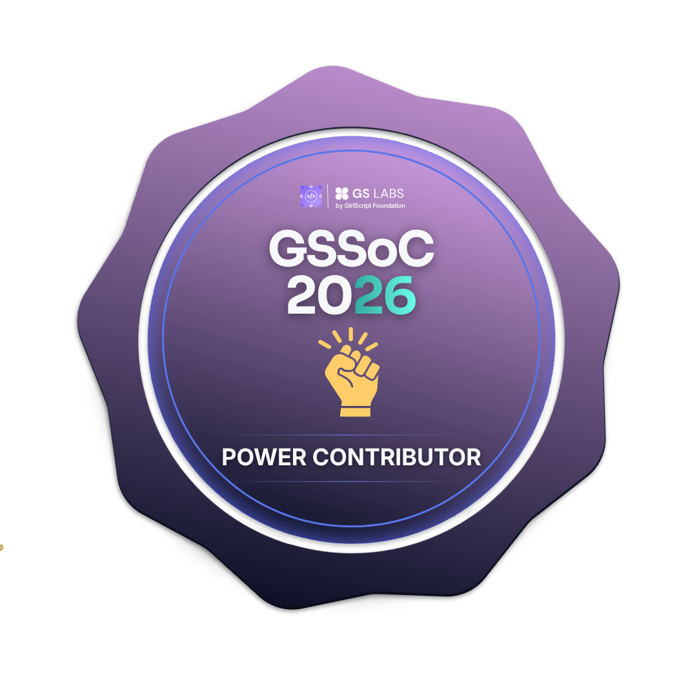
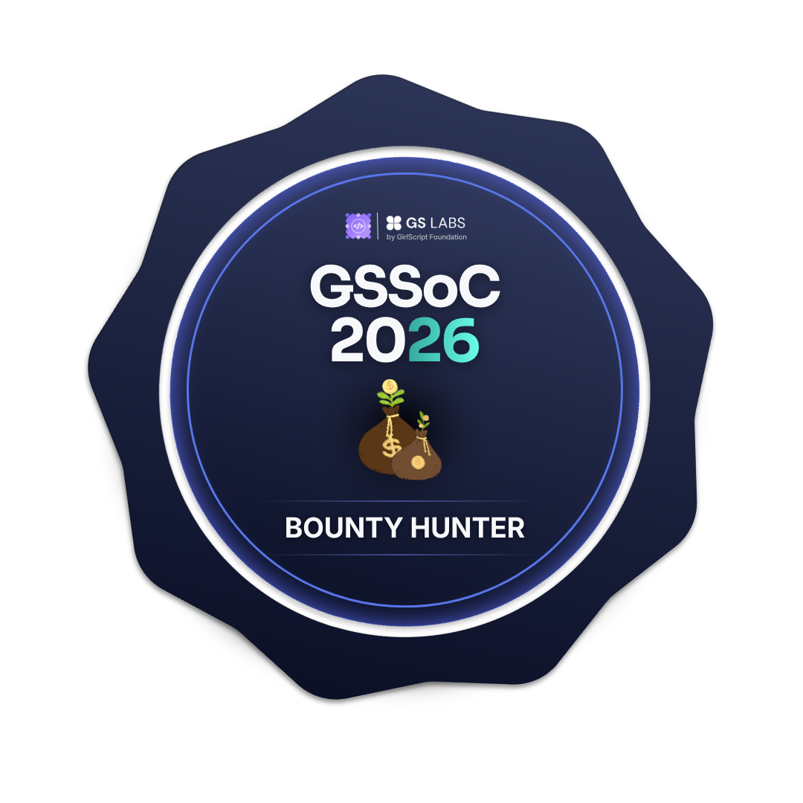
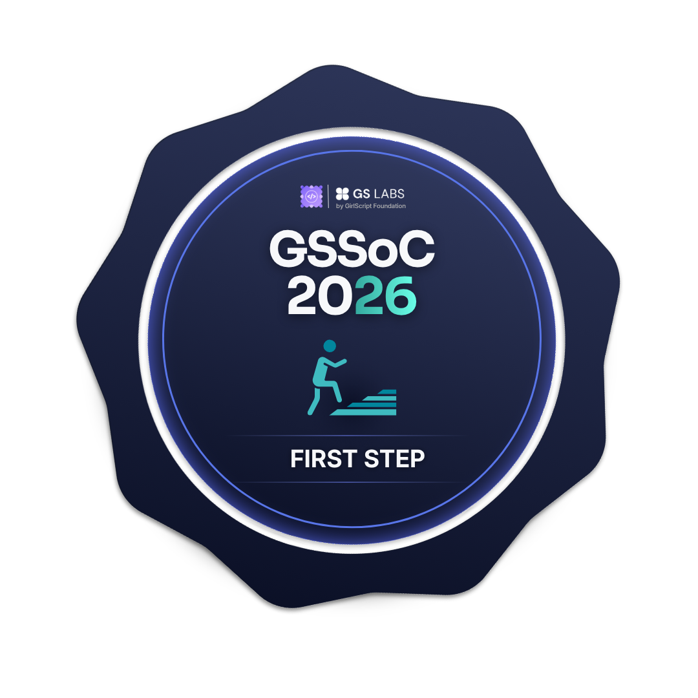
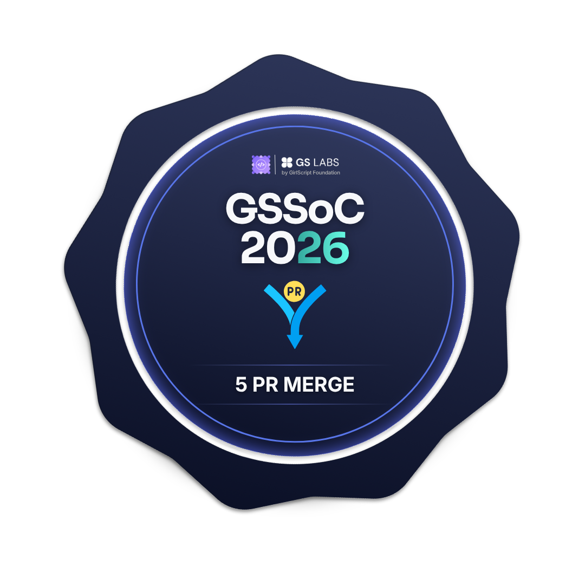
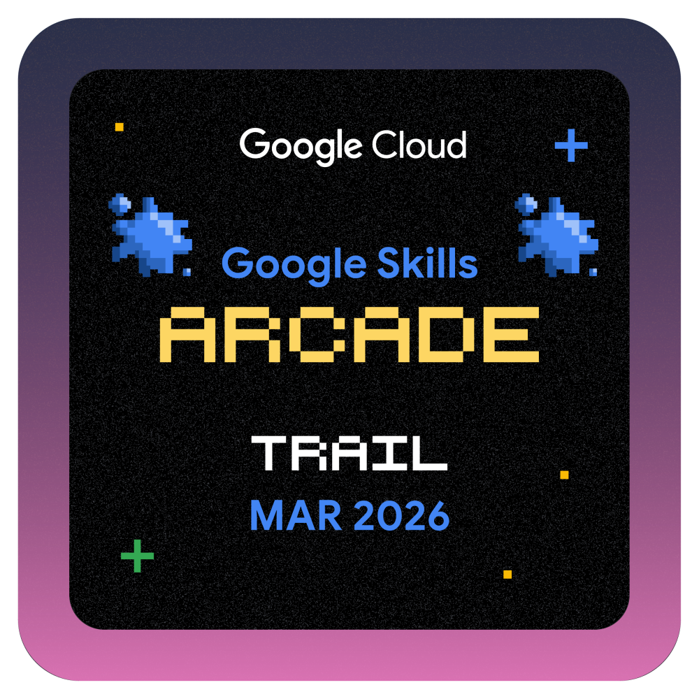

<!-- Animated Banner -->

<!-- Typing Animation -->

 

<!-- Profile Views & Followers -->

&nbsp;

## Hello 👋 , I'm Nishtha !

<!--**Nishtha-55/Nishtha-55** is a ✨ _special_ ✨ repository because its `README.md` (this file) appears on your GitHub profile.

Here are some ideas to get you started:-->

- 🔭 I’m currently working on open souce and MERN tech stack
- :paintbrush: coffee, code , and collaboration   
  :herb: creating little world through color & code  
:book: currently learning + refactoring
- 📫 How to reach me: hit the mail button :)
- 😄 Pronouns: She/her 

## 🌐 Socials:
   

## Tech Stack
### 💬 Languages

  
  
  
  
  

### 🎨 Frontend

  
  
  
  
  

### 🗄️ Backend & Database

  
  
  
  
  

##  🏅 GSSoC '26 Badges

  
   
    
  
  
  
 
    
  
  

## 🏅 Google Arcade Badges

  
  
  
  
  
  
 
    
  
  

## 🏅 Hackerrank Badges

   
  
  

## 📊 GitHub Analytics

  

## 📈 Contribution Graph

  

## 📊 GitHub Overview

  

---

**"Code is like humor. When you have to explain it, it's bad."**

⭐ *If you like what you see, consider starring some of my repos!* ⭐

